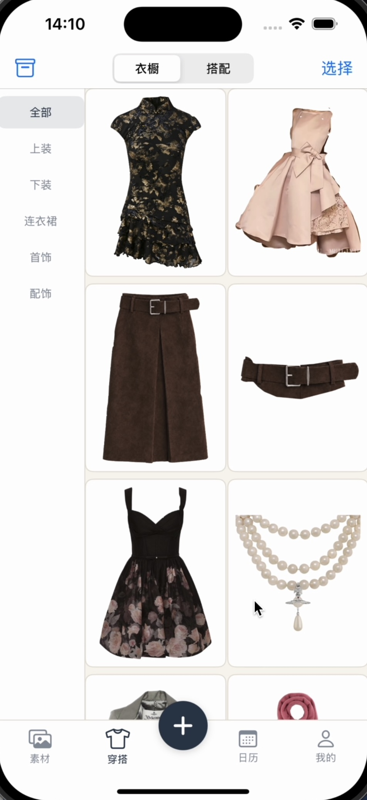
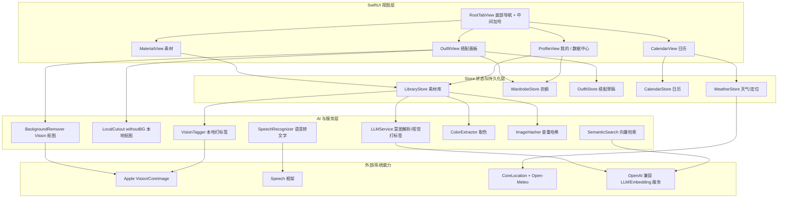
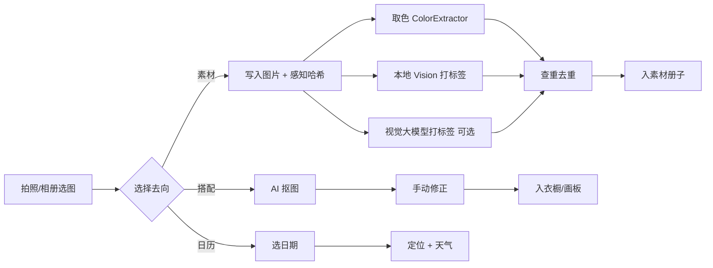
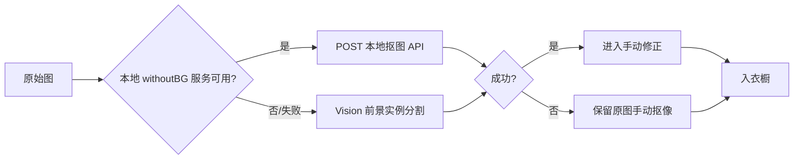
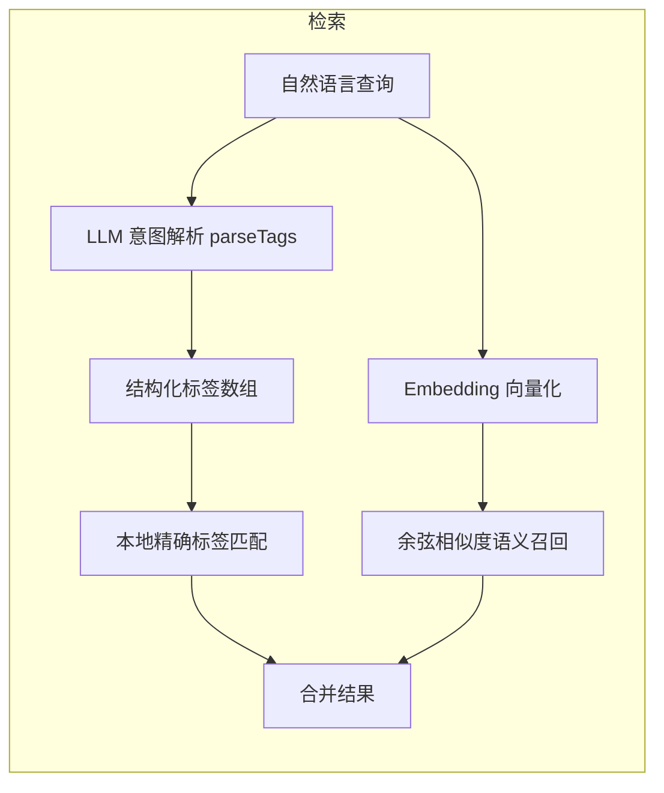

# 审美积累（Aesthetic）
## 演示

🎬 [实操演示视频（UserGuide.MOV）](https://github.com/WANG-Lingyu/aesthetic-accumulation-ios/releases/tag/v1.0)

[](https://github.com/WANG-Lingyu/aesthetic-accumulation-ios/releases/tag/v1.0)


> 一句话摘要：一款本地优先的iPhone穿搭审美素材App，解决灵感图散在相册、难以检索标注、无法自由拼搭穿搭的痛点，支持素材管理、AI抠图搭配、穿搭日历与审美数据复盘。

> 一款「沉淀审美 + 管理穿搭」的 iPhone 应用：把随手拍下的灵感图变成可检索、可标注、可搭配的私人审美素材库。

---

## 项目简介

「审美积累」是一个面向 iPhone 的私人审美素材管理应用，帮助用户把日常看到的好看的穿搭、配色、场景、姿势等灵感沉淀下来，并逐步搭建成自己的衣橱和穿搭画板。

它要解决的核心问题是：**灵感图散落在相册里、无法检索、无法标注、无法沉淀成穿搭方案**。普通相册只能按时间浏览，而审美类的需求是「按品类/颜色/风格/场景」去回顾和复用。

因此这款 App 以「素材册子」为底座，向上延伸出三块能力：

- **素材**：图片 + 册子 + 自动打标签 + 查重 + 语义检索
- **搭配**：AI 抠图 → 衣橱 → 画板自由拼搭 → 导出
- **日历**：按天记录穿搭/妆容，自动带定位 + 天气

第一阶段已完整落地「骨架 + 素材 + 搭配 + 日历」，后续规划「社区」。

**核心设计取向**：AI 本地优先（抠图、打标签优先用 iPhone 自带的 Vision，免费离线），数据完全本地化（不上传服务器），Mac 版与 iPhone 版数据各自独立、暂不互通。

---

## 核心能力

### 1. 素材库（册子 + 智能检索）

- **功能**：照片按「册子」归类（一张图可进多个册子），支持批量导入、自动查重、关键词/标签/颜色/册子名多维搜索、语义搜索（用自然语言描述也能命中近义标签）。
- **解决的问题**：灵感图散乱、找图困难、重复导入浪费空间。
- **价值**：把「相册」升级为「可检索的知识库」。

### 2. 照片详情（圈选标注 + 语音笔记 + 色卡）

- **功能**：在图片上画圈/画框标注局部（颜色可选、点击显示笔记），支持文字笔记与离线中文语音转文字笔记，自动提取图片主色生成色卡。
- **解决的问题**：一张图里有多处灵感点，无法精准记录「具体在看哪里」。
- **价值**：把「看图」升级为「精读」，每一处灵感都能落到具体位置。

### 3. AI 抠图 + 搭配画板

- **功能**：AI 抠出人物/单品主体（本地 Vision 优先，可外接 withoutBG 本地服务兜底），抠图进衣橱（上装/下装/连衣裙/鞋子/包包/首饰/配饰，支持品牌/尺码/价格），在画板上自由缩放、旋转、分层、保存多套草稿，最后导出成图回存素材册子。
- **解决的问题**：想搭配却没工具把单品抠出来自由拼贴。
- **价值**：把「收藏」升级为「可创造的搭配工作台」。

### 4. 穿搭日历（定位 + 天气）

- **功能**：按天记录穿搭/妆容/姿势/滤镜，支持从素材导入或直接拍照，自动获取定位与当天天气（历史/未来均支持）。
- **解决的问题**：记不清「哪天穿了什么」，缺少环境上下文。
- **价值**：把「当天穿搭」沉淀成可回看的时序记录。

### 5. 审美数据中心与年度报告

- **功能**：本地统计素材总数、册子数、圈选笔记、标签数、偏好色系、高频标签、衣橱分类占比，生成模板式年度报告。
- **解决的问题**：只存不用，不知道自己的审美倾向。
- **价值**：从「积累」走向「自我认知」。

---

## 效果展示

<!-- TODO: 后续可补充截图或 GIF（模拟器截图：素材册子 / 搭配画板 / 日历 / 数据中心） -->

- **输入**：相册里一张街拍图 / 一件单品图
- **输出**：自动打标签（场景·街头、人物…）→ 归入册子 → 圈选标注 → 抠图进衣橱 → 在画板组合成一套穿搭 → 导出回素材库

---

## 应用场景

- **穿搭博主/爱好者**：每天把刷到的灵感图存进册子，按「通勤 / 复古 / 甜酷」等标签检索复用。
- **普通用户管理衣橱**：给衣服拍照抠图，在画板上提前搭配好一周穿搭。
- **穿搭打卡复盘**：用日历记录每天穿搭 + 天气，月底回看自己的穿衣习惯。
- **审美自省**：通过数据中心看自己的偏好色系和高频风格标签，发现审美倾向。

---

## 安装与运行
项目包含两套独立版本：原生 iOS App（下面方式一/二/三）、PWA 网页版（HTTPS，Safari添加到主屏幕）

### 环境要求

- macOS + [Xcode](https://developer.apple.com/xcode/)（需含 iOS 17 SDK）
- iOS 17.0+ 的 iPhone / 模拟器
- 依赖说明：无外部第三方依赖，全部基于苹果原生系统框架：SwiftUI、Vision、CoreImage、Speech、CoreLocation、Charts

### 原生 iOS App
#### 方式一：让 AI 自己安装（最简单）

打开 Claude Code / 其他 AI 编码工具，粘贴：

```
请帮我运行这个 iOS 项目：
1. export DEVELOPER_DIR=/Applications/Xcode.app/Contents/Developer
2. 用 Xcode 打开 Package.swift，选 iPhone 模拟器运行
3. 确认能编译通过并启动
```

#### 方式二：命令行编译校验

```bash
export DEVELOPER_DIR=/Applications/Xcode.app/Contents/Developer
swift build -Xswiftc "-sdk" -Xswiftc "$(xcrun --sdk iphonesimulator --show-sdk-path)" \
  -Xswiftc "-target" -Xswiftc "arm64-apple-ios17.0-simulator"
```

#### 方式三：Xcode 运行

1. 用 Xcode 打开项目根目录的 `Package.swift`（或 `AestheticApp.xcodeproj`）
2. 选择一台 iPhone 模拟器
3. 点 Run

> 也可用仓库自带的脚本一键装进模拟器并启动：`./scripts/run_sim.sh`（脚本会自动查找 iPhone 16 模拟器、组装 .app、安装并启动）。

#### 配置大模型（可选，用于智能检索/视觉打标签）

本地 Vision 能力开箱即用；若想启用大模型意图解析、语义检索和视觉打标签，在 Xcode 的 **Product → Scheme → Edit Scheme → Run → Arguments → Environment Variables** 中设置（详见「配置说明」章节）。

### PWA 网页版（HTTPS，Safari 添加到主屏幕）

源码路径：`web/`，基于 MediaPipe 实现本地抠图，和原生 App 代码相互独立，能力有差异。

1. 将整个 `web/` 目录部署到支持 HTTPS 的静态托管平台（推荐 GitHub Pages / Vercel，自带 HTTPS）
2. 在 iPhone 上使用 Safari 打开部署后的 HTTPS 链接（Chrome 不支持独立 PWA 窗口）
3. 点击 Safari 底部分享按钮，下滑选择「添加到主屏幕」
4. 返回桌面，点击图标即可独立打开，无浏览器地址栏

> 
> 限制：网页环境权限弱于原生 App，相机、相册、存储受浏览器安全策略约束，主打抠图、素材预览能力，不包含原生 App 全部功能。
---

## 使用方法
🎬 快速上手演示：[你的视频链接]
观看实操演示，直观了解素材标注、AI抠图搭配、穿搭日历、审美数据统计完整流程

### 快速开始

```bash
# 1. 用 Xcode 打开 Package.swift（见「安装与运行」）
# 2. 选 iPhone 模拟器 Run
# 3. 点底部中间「＋」→ 拍照 / 从相册选择
# 4. 选择「加入素材 / 加入搭配 / 加入日历」→ 完成
```

第一次使用建议：先「从相册选择」几张图 → 加入素材 → 系统会自动打标签 → 进入详情页圈选标注 + 记笔记 → 在「我的」里查看数据中心。

### 底部导航

| 入口 | 说明 |
|------|------|
| 素材 | 册子列表 + 照片网格 + 搜索 |
| 搭配 | 衣橱 + 画板（缩放/旋转/多草稿） |
| 日历 | 按月打点，按天记录 + 天气 |
| 我的 | 设置、数据统计、审美数据中心/年度报告 |
| 中间「＋」 | 拍照 / 相册 → 选择添加到素材/搭配/日历（可多选） |

### 关键操作流程

1. **导入素材**：＋ → 相册 → 勾选「加入素材」→ 自动写入 + 打标签 + 查重（重复会弹窗提示）。
2. **圈选标注**：素材详情页 → 画圈/画框 → 选颜色 → 输入文字或语音笔记。
3. **抠图进衣橱**：＋ → 相册 → 勾选「加入搭配」→ 自动 AI 抠图 → 手动修正（保留笔/擦除笔）→ 选分类 → 填品牌/尺码/价格 → 入衣橱。
4. **搭配画板**：搭配页 → 从衣橱拖单品到画板 → 缩放/旋转/调整层级 → 存草稿或导出为图片。
5. **日历记录**：＋ → 相册 → 勾选「加入日历」→ 选日期 → 自动带定位天气。

---

## 系统架构



| 模块 | 职责 |
|------|------|
| Store 层 | 单一数据源 + JSON 原子化持久化 + 图片文件管理（全部在 App 沙盒 Documents 下） |
| 素材库 LibraryStore | 照片/册子 CRUD、批量操作、查重、标签合并 |
| 衣橱/搭配 | 抠图单品、画板草稿、画布渲染导出 |
| AI 服务层 | 本地 Vision 优先，OpenAI 兼容大模型兜底，统一协议解耦 |
| 天气 | Open-Meteo 免费接口（历史 archive / 未来 forecast）+ BigDataCloud 反地理编码 |

---

## 核心工作流程

### 导入 → 自动处理 → 入册



1. **写入**：图片以 UUID 文件名写入沙盒 `images/`，元数据写入 `library.json`。
2. **自动处理**：计算 8×8 平均哈希（查重）、提取前 5 主色（色卡）、本地 Vision 打场景/人物标签，可选视觉大模型打结构化标签。
3. **查重**：新图与库中已有图汉明距离 < 10 判定重复，弹窗确认删除。

### AI 抠图流程



抠图优先走 `LocalCutout`（withoutBG Mac 本地服务，免费离线私有），不可用或失败时自动降级到 `BackgroundRemover`（Vision `VNGenerateForegroundInstanceMaskRequest`），再失败则进手动抠像（保留笔/擦除笔）。

---

## AI 工作流程

### 本地 AI 优先（默认、免费、离线）

| 能力 | 实现 | 说明 |
|------|------|------|
| 抠图 | Vision `VNGenerateForegroundInstanceMaskRequest` | 前景实例分割，CIBlendWithMask 合成透明图 |
| 打标签 | Vision 场景分类 + 人体姿势检测 | 场景·街头/人物 等标签，真机可用 |
| 语音笔记 | SFSpeechRecognizer（zh-CN） | 离线中文语音转文字 |

### 可选大模型能力（需配置 API Key）

采用 **OpenAI 兼容协议**，天然支持豆包方舟 / OpenAI / DeepSeek 等任意兼容供应商。



- **意图解析（LLMService）**：把「浅色通勤上衣」解析成 `["浅色","上衣","通勤"]` 标签数组，`extractTagArray` 从模型输出中截取 JSON 数组，解析失败兜底返回空。
- **视觉打标签（ImageTaggingService）**：图片缩到 1024 内转 base64 data URL，多模态模型输出结构化标签，串行排队执行避免并发限流。
- **语义检索（SemanticSearch）**：查询 + 全部标签一次性批量 Embedding（只发一次请求），取「各标签与查询的最大余弦相似度」作为命中分，阈值默认 0.5。与精确标签匹配互补，解决「描述和标签用词不同但意思相近」的问题。
- **协议解耦**：`LLMService` / `ImageTaggingService` / `EmbeddingService` 均为协议，切换供应商只需换一个实现。

---

## 技术栈

| 层级 | 技术 | 用途 | 选型理由 |
|------|------|------|---------|
| UI | SwiftUI | 界面与状态驱动 | 苹果原生，声明式，Swift 包可管理 |
| 图表 | Swift Charts | 衣橱分类占比饼图 | 系统自带，无需第三方 |
| 数据持久化 | JSON + 文件系统 | 元数据 + 图片文件 | 本地优先，无后端，简单可靠 |
| 抠图 | Vision / CoreImage | 前景实例分割抠图 | 免费离线，AI 本地优先原则 |
| 打标签 | Vision | 场景分类 + 姿态检测 | 免费离线 |
| 大模型 | OpenAI 兼容 API | 意图解析 / 视觉打标签 | 供应商可换（豆包方舟/OpenAI/DeepSeek） |
| 向量检索 | Embedding + 余弦相似度 | 语义检索 | 自实现轻量检索，无需向量库 |
| 语音 | Speech / AVFoundation | 中文语音转文字 | 系统离线识别 |
| 天气 | Open-Meteo + BigDataCloud | 天气 + 反地理编码 | 免费、无需 Key |
| 查重 | 平均哈希（8×8） | 相似图去重 | 本地计算，轻量 |
| 网页版 | 原生 JS + MediaPipe + IndexedDB | PWA 演示 | 手机浏览器即用，数据本地存储 |

---

## 项目结构

```text
审美积累手机app（最终版）/
├── Package.swift              # Swift Package 定义（iOS 17+）
├── AestheticApp.xcodeproj/    # Xcode 工程
├── AestheticApp/Info.plist    # 权限描述（相机/相册/语音/麦克风）
├── Sources/AestheticApp/
│   ├── AestheticApp.swift     # @main 入口，注入各 Store
│   ├── AppTheme.swift         # 主题色（#F8F5EE / #2A3B4E）与取色扩展
│   ├── RootTabView.swift      # 底部 4 tab + 中间加号 + 添加流程编排
│   ├── Models/                # Photo/Album/Region/ColorInfo 等数据模型
│   ├── Store/                 # LibraryStore / WardrobeStore / OutfitStore / CalendarStore
│   ├── Services/              # AI 与服务（抠图/打标签/取色/哈希/检索/天气/语音）
│   └── Views/                 # 各 tab 视图与弹层（素材/搭配/日历/详情/统计…）
├── web/                       # 手机网页版（PWA）：素材册子 + 人物 AI 抠图
│   ├── index.html / app.js / db.js   # 界面 / 逻辑 / IndexedDB 数据层
│   ├── cutout.js              # MediaPipe Selfie Segmentation 抠图
│   └── mediapipe/             # 本地模型（tflite/wasm）
├── scripts/run_sim.sh         # 一键装进模拟器并启动
├── docs/                      # 需求 / 计划文档
└── 开发日志/                   # 每日开发日志与待办事项
```

---

## 配置说明

大模型相关配置全部通过 **Xcode Scheme 环境变量**注入，源码中无任何真实密钥（见 `LLMService.swift` 的 `LLMConfig`）。

| 变量名 | 必需 | 默认值 | 说明 |
|--------|------|--------|------|
| `LLM_API_KEY` | 意图解析时需要 | `YOUR_API_KEY` | 大模型 API Key |
| `LLM_API_BASE_URL` | 否 | 豆包方舟 chat 地址 | 对话接口（OpenAI 兼容） |
| `LLM_API_MODEL` | 意图解析时需要 | `YOUR_MODEL_ID` | 文本模型 ID |
| `LLM_API_VISION_MODEL` | 视觉打标签时需要 | 复用 `LLM_API_MODEL` | 视觉（多模态）模型 ID |
| `LLM_API_VISION_BASE_URL` | 否 | 复用 `LLM_API_BASE_URL` | 视觉接口地址 |
| `LLM_API_VISION_KEY` | 否 | 复用 `LLM_API_KEY` | 视觉模型独立 Key |
| `LLM_API_EMBEDDING_BASE_URL` | 否 | 豆包方舟 embeddings 地址 | Embedding 接口 |
| `LLM_API_EMBEDDING_MODEL` | 语义检索时需要 | `YOUR_EMBEDDING_MODEL_ID` | Embedding 模型 ID |

未配置时，App 自动回退为「纯本地 Vision + 精确标签匹配」，功能仍可用，只是没有大模型智能检索与视觉打标签。

---

## 性能与扩展性

- **本地优先**：核心 AI（抠图/打标签/语音）都在设备端完成，无服务器成本、无网络延迟。
- **串行防限流**：视觉打标签用 `Task` 链串行排队，避免并发触发供应商限流。
- **批量 Embedding**：语义检索把查询 + 全部标签合并为一次请求，减少往返。
- **缩略图缓存**：衣橱单品缩略图裁剪透明边后缓存，避免重复解码。
- **优化方向**：图片量大后可引入 SQLite/GRDB 替代纯 JSON；语义检索可预计算并缓存标签向量，避免每次检索都重新 Embedding。

---

## 安全设计

- **数据本地化**：所有素材、衣橱、日历数据仅存于 App 沙盒 Documents 目录，不上传服务器（网页版存 IndexedDB，同样本地）。
- **密钥安全**：API Key 只通过环境变量注入，源码仅占位符；正式环境建议由服务端中转持有密钥，客户端不直接暴露。
- **隐私权限**：相机、相册、语音识别、麦克风均按需申请，Info.plist 有明确用途说明。
- **无账号体系**：当前为纯单机应用，无身份认证需求。

---

## 项目亮点

1. **技术创新 — AI 本地优先 + 分级降级**：抠图「withoutBG 本地服务 → Vision 前景分割 → 手动抠像」三级降级，打标签「Vision → 视觉大模型」两级，任何一级不可用都不影响主流程。
2. **工程创新 — 协议解耦可替换 LLM**：`LLMService` / `ImageTaggingService` / `EmbeddingService` 全协议化，OpenAI 兼容格式让豆包方舟/OpenAI/DeepSeek 无缝切换。
3. **工程创新 — 轻量自实现检索**：不引向量库，用「查询 + 标签批量 Embedding + 余弦相似度」实现语义检索，配合精确标签匹配形成「精确 + 语义」双路召回。
4. **产品创新 — 细节可标注的素材库**：圈选标注（坐标归一化 + 颜色 + 隐藏笔记）、色卡、感知哈希查重、语音笔记，把「存图」做成了「精读」。
5. **产品创新 — 双端形态**：原生 iPhone App + 手机网页 PWA 双形态，共享同一套「本地优先」理念，网页版用 MediaPipe 在浏览器内完成 AI 抠图。

---

## Roadmap

- [x] M0 iOS 骨架 + 主题色 + 底部菜单 + 中间加号
- [x] M1 数据层（模型 + 本地存储 + 图片文件）
- [x] M2 素材页（册子 + 照片网格 + 归类）
- [x] M3 加号相机/相册 → 跳素材备注分类
- [x] M4 素材详情（大图 + 备注 + 分类）
- [x] 批量导入 + 自动查重
- [x] 搜索（关键词 / 标签 / 颜色 / 册子名）
- [x] 册子增强（封面/改名/数量/创建时间/册内排序）
- [x] 批量操作（多选 → 一图多册 / 删除）
- [x] 详情圈选 + 文字/语音笔记 + 色卡
- [x] AI 本地标签 + 私人词库
- [x] 审美数据中心 + 年度报告（本地模板式）
- [x] 搭配（衣橱 / AI 抠图 / 画板）
- [x] 日历（按天记录 + 天气）
- [ ] 社区（第三阶段）
- [ ] AI 审美报告深化
- [ ] Mac / iPhone 数据互通

---

## 贡献指南

1. Fork 本仓库
2. 创建功能分支：`git checkout -b feature/your-feature`
3. 提交更改（遵循 Conventional Commits）：`git commit -m 'feat: add your feature'`
4. 推送分支：`git push origin feature/your-feature`
5. 提交 Pull Request

> 开发约定：小步稳定推进，每个里程碑「编译通过 → 模拟器验证 → 更新开发日志 → 汇报」后再进入下一步。

---

## FAQ

### 为什么大模型检索/打标签没生效？

默认走本地 Vision，功能可用。若要用大模型，需在 Xcode Scheme 环境变量里设置 `LLM_API_KEY` 和 `LLM_API_MODEL`（视觉打标签还需 `LLM_API_VISION_MODEL`）。未配置时 `LLMConfig.isConfigured` 为 false，相关能力静默跳过。

### 抠图在模拟器上为什么失败？

Vision 前景分割在模拟器上不稳定（可能卡死/崩溃），`BackgroundRemover` 检测到模拟器会直接返回失败，转手动抠像；真机上正常。如需模拟器抠图，可在 Mac 安装 withoutBG 并开启本地 API（`127.0.0.1:8000`）。

### 数据和图片存在哪里？

iOS 版存在 App 沙盒 `Documents/审美积累/` 下（`library.json`、`calendar.json`、`wardrobe.json`、`outfit_drafts.json` 及各 `images/` 目录）；网页版存在浏览器 IndexedDB。均不上传服务器。

### Mac 版和 iPhone 版数据互通吗？

暂不互通，两者数据各自独立。

---

## 贡献与许可

本项目尚未指定 License。当前为私有/个人作品集项目，如需二次使用请先联系作者。
